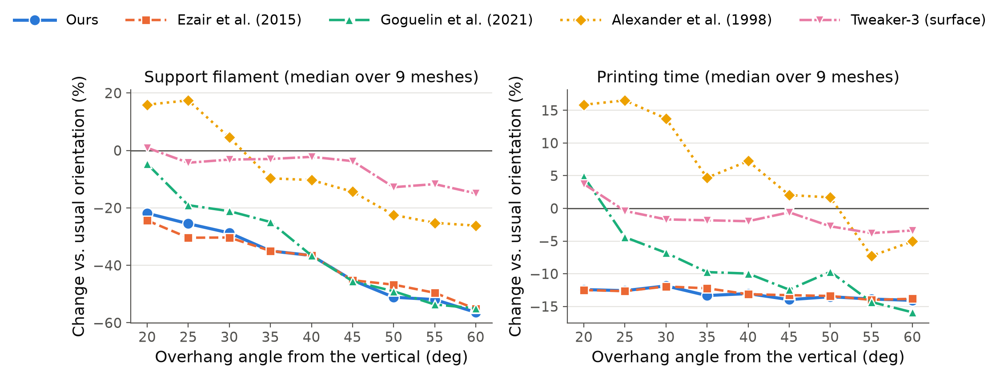

# overhang-bench

Benchmark of build-orientation methods for FDM printing, built to continue
Castro (2020), *Optimal rotations for overhang reduction* (MSc dissertation,
UFSC), and to compare it with other methods under one protocol. It accompanies
the paper *Normal-field-based global orientation for support reduction in 3D
printing* (C. E. L. de Castro and L. Sacht, under review).



Code released under the [MIT License](LICENSE). The meshes are not part of the
repository and remain under the terms of their original sources.

## Quick start (about 10 minutes)

You need git, CMake ≥ 3.20, a C++17 compiler and Python 3 with numpy and
matplotlib. On Ubuntu/Debian the viewer also needs the OpenGL/X11 headers:
`sudo apt install build-essential cmake git xorg-dev libgl1-mesa-dev`.
On macOS, the Xcode command-line tools and `brew install cmake` are enough.

```bash
git clone https://github.com/carloselcastro/overhang-bench.git
cd overhang-bench
cmake -S . -B build                 # downloads libigl, Eigen, LBFGSpp, Polyscope
cmake --build build -j              # builds build/bench and build/viewer
python3 scripts/fetch_meshes.py     # the seven libigl meshes -> meshes/
```

**Play with the viewer.** Open any mesh; without other options the viewer
optimizes the orientation at startup and lets you switch between the initial
pose and the pose found by each objective:

```bash
./build/viewer meshes/bunny.off
./build/viewer meshes/cow.off --overhang-deg 50 --size-mm 100
./build/viewer path/to/your_part.stl          # OBJ, OFF, STL and PLY work
```

With the precomputed results of the repository, the viewer also shows the
poses of the external baselines (Tweaker-3) and the PrusaSlicer estimates:

```bash
./build/viewer meshes/horse_quad.obj --poses results/all_poses.csv --prusaslicer results/prusaslicer.csv
```

In the viewer: drag to rotate, scroll to zoom; the `pose` combo switches
between methods, `landscape` draws the objective on the sphere of build
directions and on the (θ₁, θ₂) rectangle, `overhang (deg)` recolours the
faces that need support, and `layer view` slices the part.

**Compare the poses side by side.** After the quick start, this opens the cow
with the pose of every method on the plate, left to right, the faces that
need support in red and the support columns of the proxy model in green (an
approximation, not the slicer's supports), and a table of their PrusaSlicer
estimates (support filament, total filament, time):

```bash
./build/viewer meshes/cow.off --poses results/all_poses.csv --prusaslicer results/prusaslicer.csv --compare
```
```powershell
.\build\viewer.exe meshes\cow.off --poses results\all_poses.csv --prusaslicer results\prusaslicer.csv --compare
```

The same view is the checkbox `side by side (all poses)` in the panel; the
order is that of the `pose` combo, and each part is labelled with its number and
name in the 3D view (the numbers of the table). Pose names: `initial` is the usual
orientation (the file as distributed, only placed on the plate), `castro-eq`
the proposed method (Eq. 5), `ezair`, `goguelin-len` and `alexander` the
methods of Ezair et al. (2015), Goguelin et al. (2021) and Alexander et al.
(1998), `tweaker3-vol`/`tweaker3-sur` the Tweaker-3 tool with its volume and
surface criteria (see [Methods](#methods)). These are the methods of the paper.

For a labelled image instead (one row per mesh, one column per method, the
proposed method in teal, PrusaSlicer's support filament and time under each
part, all parts of a row at the same scale):

```bash
python3 scripts/compare_poses.py --out compare       # compare/all_meshes.png and compare/<mesh>.png
python3 scripts/compare_poses.py --out compare --meshes cow,bunny --poses initial,castro-eq,alexander,ezair
```

Meshes missing from `meshes/` (heart and skull, until downloaded by hand) are
skipped.

**Optimize from the command line.**

```bash
./build/bench --out my_results --objectives castro-eq,alexander \
              --searches mcd,sphere meshes/cow.off meshes/bunny.off
```

writes `my_results/orientations.csv` (best angles and objective value per
objective × search) and the placed STLs, ready for any slicer.

**Reproduce the paper's tables** (needs PrusaSlicer; Tweaker-3 is optional):
see [Run everything](#run-everything) below. The results used in the paper are
already in `results/` (one configuration, `report.md` summarizes it) and in
`results_angles/sweep_summary.{csv,md}` (support-angle sweep).

On Windows, run the same commands in PowerShell with `.\build\viewer.exe`
etc.; if you built with MinGW, put its `bin` directory first on `PATH` so
that the right C++ runtime DLLs are found.

| part | what it does |
|---|---|
| `include/ob/objectives.hpp` | orientation objectives *f(d)*, *d* ∈ S² the build direction in the object frame |
| `include/ob/optimize.hpp` | search strategies (exhaustive grid, the dissertation's multistarts, S² sampling, Ezair's scheme) |
| `include/ob/simulate.hpp` | fast print-cost **proxy** (vertical support columns, rough material/time model) |
| `src/bench.cpp` | command-line benchmark → CSVs + placed STLs |
| `src/viewer.cpp` | interactive Polyscope viewer (part, supports, layer slider, objective on S²) |
| `scripts/pipeline.py` | **everything in one command**: optimize, baselines, slicer, report; size × angle sweep |
| `scripts/slice_prusaslicer.py` | reference estimates from PrusaSlicer's CLI (time, filament, support filament) |
| `scripts/run_tweaker.py`, `scripts/run_orca.py` | external baselines (Tweaker-3, OrcaSlicer/Bambu Studio auto-orient) |
| `scripts/analyze.py` | report: reproduction check, search comparison, per-method summary, proxy vs. slicer |
| `scripts/latex_table.py` | LaTeX (booktabs) table of the slicer estimates per mesh and method |
| `scripts/head_to_head.py` | Table 4 of the paper: our orientation against each other method (median difference, less/equal/more counts, totals); `--text` lists the per-mesh values |
| `scripts/plot_angle_sweep.py` | figure: median change in support and time vs. overhang angle, per method |
| `scripts/make_figures.py` | Figures 5–10 and 12 of the paper: Knight landscape, local minima (sliced), multistart starts and minima, renders via `viewer --figure` (Figs. 5 and 12 with PrusaSlicer's own supports) |
| `scripts/support_paths.py` | support toolpaths of a PrusaSlicer G-code in the frame of the sliced STL, for `viewer --figure --support-paths DIR` |
| `scripts/compare_poses.py` | side-by-side renders of the pose of every method, per mesh, with the PrusaSlicer estimates |
| `scripts/find_prerotation.py` | finds the pre-rotation that reproduces the dissertation's frame for a mesh |

## Build

Requirements: CMake ≥ 3.20, a C++17 compiler, git, Python ≥ 3.8 with numpy.
libigl 2.5, Eigen, LBFGSpp and Polyscope 2.3 are downloaded by CMake.

```powershell
cmake -S . -B build
cmake --build build --config Release -j
```

On Windows (PowerShell) run executables with a leading `.\`. With the Ninja
generator they are in `build\`; with the Visual Studio generator, in
`build\Release\`. `-DOB_BUILD_VIEWER=OFF` builds only the benchmark (no OpenGL).

External tools (only for the corresponding steps):
[PrusaSlicer](https://www.prusa3d.com/page/prusaslicer_424/) (reference slicer),
[Tweaker-3](https://github.com/ChristophSchranz/Tweaker-3) (`git clone` next to this folder),
[OrcaSlicer](https://github.com/SoftFever/OrcaSlicer) (optional).

## Meshes and frames

`python scripts/fetch_meshes.py` downloads the libigl meshes of the
dissertation into `meshes/`. `data/castro2020_meshes.csv` lists every mesh,
its source and the angles of Table 4.2.1; the face counts match Table 4.1.1
exactly. Heart and skull come from Sketchfab and are not redistributed here:
download them by hand into `meshes/` as `heart.obj` and `skull.obj` (links in
the manifest and in the paper's references); meshes whose file is missing are
skipped.

**Initial pose.** The initial ("usual") pose of every mesh is the file as
distributed, read with z as the build direction, with no rotation. For Knight
and Max, the dissertation's computations were made on the file rotated by
90° about x (Max also by 180° about z); the manifest gives their angles
converted to the frame of the distributed file, which describe the same
physical orientation.

A mesh argument may carry a pre-rotation: `file@rx90,rz180` (degrees, fixed
axes, applied left to right), e.g. for a file in the y-up convention. For a
mesh whose frame is unknown, `scripts/find_prerotation.py` tries the 24
axis-aligned rotations and reports the one whose `castro-eq` optimum matches
given angles:

```bash
python scripts/find_prerotation.py meshes/decimated-knight.off --t1 -1.4726 --t2 0.0074   # -> rx90
```

## Run everything

```powershell
$PRUSA = "C:\Program Files\Prusa3D\PrusaSlicer\prusa-slicer-console.exe"
python scripts\pipeline.py run --out results --prusa $PRUSA --tweaker ..\Tweaker-3\Tweaker.py --slicer-threads 1
#   add  --orca "C:\Program Files\OrcaSlicer\orca-slicer.exe"  for OrcaSlicer's auto-orient
python scripts\pipeline.py sweep --base results --out results_sweep --prusa $PRUSA --tweaker ..\Tweaker-3\Tweaker.py --slicer-threads 1
```

`run` writes to `results/`: `orientations.csv` (every objective × search),
`all_poses.csv`, `print_proxy.csv`, `poses_eval.csv` (every objective at every
pose), `prusaslicer.csv`, `stl/` and `report.md`. `sweep` repeats the
evaluation for part sizes 40/60/100 mm and overhang angles 40/45/50° and writes
`results_sweep/sweep_summary.{csv,md}`; see the docstring of `pipeline.py` for
what is re-optimized per configuration. Options: `--size-mm`,
`--overhang-deg`, `--meshes arm,cow`, `--jobs N` (parallel slicing).

**Slicer determinism.** Multithreaded PrusaSlicer 2.9.6 is not deterministic on
some meshes: slicing the initial skull four times at a 60° overhang angle gave
support filament between 2.62 and 3.03 m. With `--slicer-threads 1` the
same four slicings were identical, so all published numbers use it (raise
`--jobs` to make up for it).

**Pose of the proposed method.** The sliced pose of `castro-eq` is the
best minimizer of the two multistart strategies of the
paper (`mcd`, `rcsp`); `grid` and `sphere` are run only for comparison
(`POSE_SEARCHES` in `pipeline.py`). `ezair` uses the search scheme of Ezair et
al.; `alexander` and `goguelin-len` use the `sphere` search with 4000
directions (`--sphere-n`), in `run` as in `sweep`, so `results/` and the 45°
configuration of `results_angles/` hold the same poses.

**Support-angle sweep.** The overhang angle is a user setting of the slicer.
`--overhang-deg` is measured from the vertical; the slicer script converts it
to PrusaSlicer's `support_material_threshold` (measured from the horizontal) as
90 − value. To test 20–60°:

```powershell
python scripts\pipeline.py sweep --base results --out results_angles --sizes 60 --angles 20,25,30,35,40,45,50,55,60 --prusa $PRUSA --tweaker ..\Tweaker-3\Tweaker.py --slicer-threads 1
python scripts\plot_angle_sweep.py results_angles\sweep_summary.csv --out fig_angle_sweep
```
`castro-eq` and `ezair` have no angle parameter (same pose for every angle);
`alexander` and `goguelin-len` are re-optimized for each angle.

The individual steps (`bench`, `slice_prusaslicer.py`, `run_tweaker.py`,
`collect_poses.py`, `analyze.py`) can also be run by hand; each has `--help`.

## Methods

| id | definition |
|---|---|
| `castro-eq` | the proposed method, Eq. (5) of the paper (eq. (3.2.4) of Castro 2020): face area × (barycentric height − min z over all vertices) × squared z-component of the normal |
| `alexander` | Alexander, Allen & Dutta (1998), CAD 30(5):343–356, as summarized in Castro (2020) §3.3, eq. (3.3.7); z_t = p = q = 0.1 cm, R = 10, lengths in cm |
| `goguelin-len` | Goguelin, Dhokia & Flynn (2021), Int. J. Computer Integrated Manufacturing 34(12):1263–1284, §3.3: facets whose normal lies within θ_crit (= the slicer's overhang angle) of the downward direction; rays cast downwards from their centroids to the first collision with the mesh or the plate; eq. (2), the sum of the ray lengths. Their optimizers (grid/random/Bayesian) are replaced by the `sphere` search |
| `ezair` | Ezair, Massarwi & Elber (2015), Computers & Graphics 51:117–124: support volume V(S) = V(T) − V(M), T the "top cover" down to the lowest point, no self-supporting angle (Def. 3.1, Cor. 3.2); z-buffer of 1024² pixels over the bounding-sphere square (their Alg. 1, on the CPU) |
| `tweaker3-vol`, `tweaker3-sur` | Tweaker-3 (Schranz), extended mode, minimizing support volume / overhang surface |
| `orca-orient` | optional, not in the paper or in `results/`: OrcaSlicer/Bambu Studio `--orient 1` (weighted cost of overhang area, bottom contact, hull area, contour complexity, low-angle faces — OrcaSlicer wiki) |

All objectives depend on (θ₁, θ₂) only through *d* = R(θ₁,θ₂)ᵀe₃ =
(−sin θ₂, sin θ₁ cos θ₂, cos θ₁ cos θ₂), i.e. they are functions on S².
`castro-eq` and `ezair` are homogeneous in the scale and have no overhang
parameter, so their optima do not depend on part size or overhang angle.

### Search strategies

| id | description |
|---|---|
| `grid` | exhaustive grid, step Δ (361 × 181 = 65 341 evaluations for Δ = π/180), as in §3.4 |
| `mcd` | multiple constraint division: 32 local solves from the centres `(ii+h/2, jj+h/2)` of the cells of size h = π/4 |
| `rcsp` | 32 local solves from uniform random points (seed 1) |
| `sphere` | Fibonacci lattice on S² (Gonzalez 2010) + local refinement of the 8 best samples |
| `ezair` | Ezair et al.'s scheme: 5° sampling (72 × 36) + derivative-free coordinate search of Lucidi & Sciandrone (2002) from the 100 best samples |

Local solvers: L-BFGS-B (Byrd, Lu, Nocedal & Zhu 1995) with central
differences for smooth objectives; Nelder–Mead (1965) for non-smooth ones.
The parameters of the Lucidi–Sciandrone search (γ = 1e-6, step factors 0.5,
initial step 2.5°, tolerance 1e-4 rad) are ours; Ezair et al. do not report them.

## The proxy is not a slicer

`simulate.hpp` estimates support as vertical columns under faces steeper than
the overhang angle and turns volumes into filament/time with a linear model.
It exists to rank poses fast. Absolute numbers must come from the slicer, and
the proxy should be reported with its rank correlation to the slicer
(`report.md`, §4). PrusaSlicer's numbers are **estimates** from its G-code
time model, not measurements of printed parts; the version used is recorded
in `prusaslicer.csv` and in the report.

## Viewing surfaces

```powershell
$P = "--poses", "results\all_poses.csv", "--prusaslicer", "results\prusaslicer.csv"
.\build\viewer.exe "meshes\arm.obj"                        @P
.\build\viewer.exe "meshes\bunny.off"                      @P
.\build\viewer.exe "meshes\camel_b.obj"                    @P
.\build\viewer.exe "meshes\cow.off"                        @P
.\build\viewer.exe "meshes\horse_quad.obj"                 @P
.\build\viewer.exe "meshes\decimated-knight.off"          @P
.\build\viewer.exe "meshes\decimated-max.obj"             @P
.\build\viewer.exe "meshes\heart.obj"                     @P   # after downloading it
.\build\viewer.exe "meshes\skull.obj"                     @P   # after downloading it
```

`--poses` shows every method (optimizers and external baselines);
`--orientations results\orientations.csv` shows only the optimizers. The
pre-rotation after `@` must match the one used by `bench`, otherwise the stored
angles refer to a different frame.

Any other surface (OBJ, OFF, STL, PLY): without `--poses`/`--orientations` the
viewer optimizes `castro-eq` and `alexander` at startup.

```powershell
.\build\viewer.exe "C:\path\to\part.stl"
.\build\viewer.exe "C:\path\to\part.obj@rx90"      # file uses the y-up convention
.\build\viewer.exe "meshes\cow.off" --size-mm 100 --overhang-deg 50
```

To put a new surface in the benchmark tables, add a line to
`data/castro2020_meshes.csv` (or a manifest of your own) and run the pipeline.

| control | effect |
|---|---|
| left drag / scroll | rotate / zoom |
| `pose` | initial pose or the pose of each method |
| `landscape` | objective drawn on S² and on the (θ₁, θ₂) rectangle; dots = poses (Ezair's at 256², computed on demand) |
| `overhang (deg)` | recolors overhang faces and recomputes the support columns |
| `layer view` + `layer` | slice plane at the chosen fraction of the height |
| `side by side (all poses)` | every pose on the plate, left to right, with overhang faces, proxy support columns and a table of the estimates of all poses (also `--compare`) |
| side panel | proxy estimates (and PrusaSlicer's, if `--prusaslicer` was given) |
| `save image` | saves the view (white background, no panels) to `screenshots/<mesh>__<pose or compare>__<date-time>.png` in the folder the viewer was started from, never overwriting; in side-by-side mode also a `.txt` with the poses left to right and their PrusaSlicer estimates. Polyscope's own `Screenshot` button writes `screenshot_000000.png`, … in the same folder and restarts the numbering in every session, overwriting older files |

## Adding a method

*Objective-based* (anything that scores a direction): derive from
`ob::Objective`, implement `double eval(const Vector3d& d) const`, return
`smooth() = false` if it is not differentiable, and add it to
`make_objective()`. Every search strategy, the proxy, the STL export, the
slicer script and the viewer then work unchanged.

*External tool* (a program that returns an orientation): write a CSV with
`mesh,pose,t1,t2` (see `run_tweaker.py`, `run_orca.py`) and pass it to
`bench --searches none --poses that.csv <meshes>` or add it to `external()`
in `pipeline.py`.
